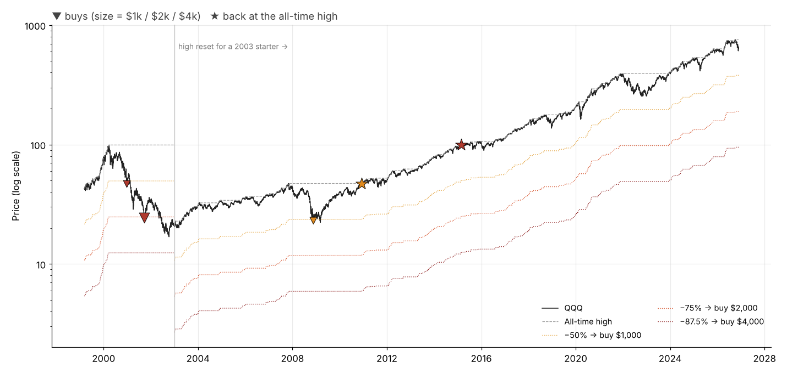
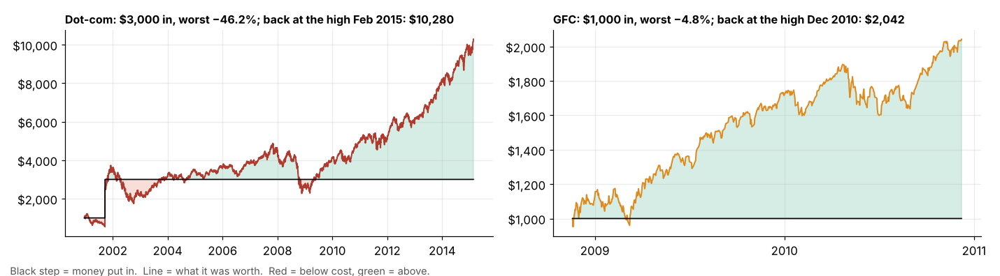
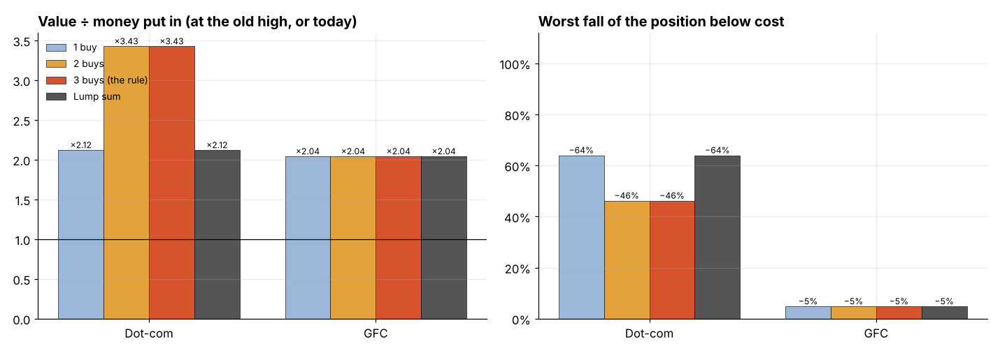

<!-- Written by _code/halving_strategy.py; do not edit by hand. Last run 2026-11-27 14:06 UTC. -->

What happens if you buy QQQ only after it has been cut in half, and buy more each time it halves again?

<b>The rule.</b> When QQQ closes 50% below its all-time high, buy <b>$1,000</b>.
If it halves again (−75% from the high), buy <b>$2,000</b>. If it halves a third time (−87.5%), buy <b>$4,000</b>.
Hold until QQQ closes back at that high. At most $7,000 goes in per sell-off.

<b>Where QQQ is now</b> (Nov 25, 2026): $633.93, −16.6% from its closing high of $759.66 (Oct 6, 2026). Buy levels from that high: −50% = <b>$379.83</b> ($1,000) · −75% = <b>$189.91</b> ($2,000) · −87.5% = <b>$94.96</b> ($4,000). No buy level has been hit since this high.

## Key findings

- The rule fired in **2** sell-offs: the first buy ($1,000) every time, the second ($2,000, at −75%) in **1**, and the third ($4,000, at −87.5%) in **0**.
- In the **2** that ended, the money came back as ×2.04 to ×3.43 by the day QQQ regained its old high, which took 2.1 to 14.2 years from the first buy (median 8.1).
- The worst ride was **Dot-com**: $3,000 put in fell to $1,613 (−46.2%) in September 2001.
- The longest wait was **Dot-com**: 14.2 years.
- Doubling down helps most when the fall keeps going. In Dot-com, the three-step rule turned $3,000 into ×3.43, against ×2.12 for putting all $7,000 in at −50%: the later, larger buys come in at a quarter of the high.

## Every sell-off that triggered the rule

<table><thead><tr><th>Sell-off</th><th>Low</th><th class=wrap>Buys</th><th>Put in</th><th>Worst</th><th>Above cost for good</th><th>Back at high <small>years after 1st buy</small></th><th>Worth then</th><th>Held to today</th></tr></thead><tbody><tr><th>Dot-com <small>high Mar 2000</small></th><td class=dn>−83.0%</td><td>$1k Dec 2000 $2k Sep 2001</td><td>$3,000</td><td class=dn>−46.2% <small>$1,613 · Sep 2001</small></td><td>May 2009</td><td>Feb 2015 <small>14.2 yrs</small></td><td>$10,280 <small class=up>×3.43</small></td><td>$65,504</td></tr><tr><th>GFC <small>high Oct 2007</small></th><td class=dn>−53.4%</td><td>$1k Nov 2008</td><td>$1,000</td><td class=dn>−4.8% <small>$952 · Nov 2008</small></td><td>Mar 2009</td><td>Dec 2010 <small>2.1 yrs</small></td><td>$2,042 <small class=up>×2.04</small></td><td>$27,440</td></tr></tbody></table>

Worst = lowest value of the position against the money in at that point. Above cost for good = the day after the last close below cost.
Back at high = first close at or above the all-time high the fall started from. Worth then = the position on that day (or today, if not back yet).
If held to today = the same shares valued at the last close. The dot-com row is for someone watching since 1999; every later row is for someone who
started in 2003, after the bust (a 1999 holder still measures from the March 2000 high, so for them the later sell-offs are not new signals).

## The whole history

## Each sell-off, dollar by dollar

## Is doubling down better than the alternatives?

Same trigger levels, different amounts: only the first buy, the first two, all three, or all $7,000 at once at −50%.

<table><thead><tr><th>Rule</th><th>Dot-com</th><th>GFC</th></tr></thead><tbody><tr><th>1 buy <small>$1k at -50% only</small></th><td>$1,000 → $2,120 (×2.12) <small>worst −64.0%</small></td><td>$1,000 → $2,042 (×2.04) <small>worst −4.8%</small></td></tr><tr><th>2 buys <small>$1k at -50%, $2k at -75%</small></th><td>$3,000 → $10,280 (×3.43) <small>worst −46.2%</small></td><td>$1,000 → $2,042 (×2.04) <small>worst −4.8%</small></td></tr><tr><th>3 buys (the rule) <small>$1k / $2k / $4k at -50 / -75 / -87.5%</small></th><td>$3,000 → $10,280 (×3.43) <small>worst −46.2%</small></td><td>$1,000 → $2,042 (×2.04) <small>worst −4.8%</small></td></tr><tr><th>Lump sum <small>all $7k at -50%</small></th><td>$7,000 → $14,843 (×2.12) <small>worst −64.0%</small></td><td>$7,000 → $14,296 (×2.04) <small>worst −4.8%</small></td></tr></tbody></table>

## How this was computed

- Daily adjusted closes from Yahoo Finance (dividends reinvested), March 1999 to November 25, 2026. Buys happen at the close of the first day a level is reached; a gap down can fill a level below it.
- No taxes, trading costs, or interest on cash waiting to be invested.
- A backward look at a handful of episodes, not advice. The sample is small, and the dot-com bust shows how long "eventually" can be.

See also: [TQQQ: Buying the Halvings](/halving-tqqq/) · [Market snapshot](/test/#market-snapshot)

