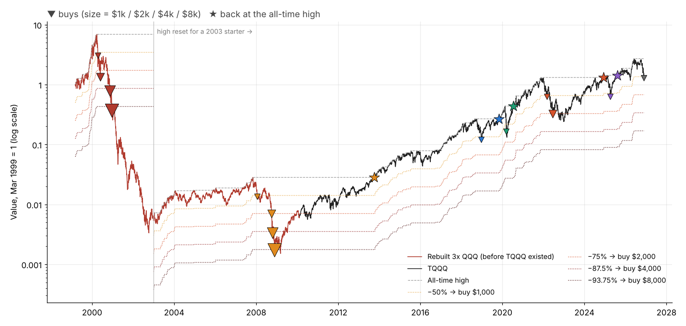
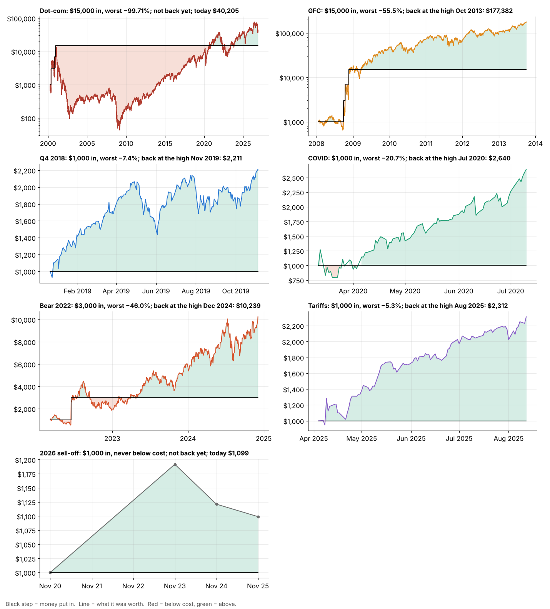
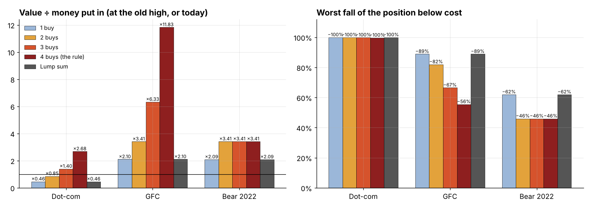

<!-- Written by _code/halving_strategy.py; do not edit by hand. Last run 2026-11-27 14:20 UTC. -->

What happens if you buy TQQQ only after it has been cut in half, and buy more each time it halves again?

<b>The rule.</b> When TQQQ closes 50% below its all-time high, buy <b>$1,000</b>.
If it halves again (−75% from the high), buy <b>$2,000</b>. If it halves a third time (−87.5% from the high), buy <b>$4,000</b>. If it halves a fourth time (−93.75% from the high), buy <b>$8,000</b>.
Hold until TQQQ closes back at that high. At most $15,000 goes in per sell-off.

<b>Where TQQQ is now</b> (Nov 25, 2026): $45.28, −48.1% from its closing high of $87.22 (Jun 2, 2026). Buy levels from that high: −50% = <b>$43.61</b> ($1,000) · −75% = <b>$21.81</b> ($2,000) · −87.5% = <b>$10.90</b> ($4,000) · −93.75% = <b>$5.45</b> ($8,000). Already hit since the high: −50%.

## Key findings

- The rule fired in **7** sell-offs: the first buy ($1,000) every time, the second ($2,000, at −75%) in **3**, the third ($4,000, at −87.5%) in **2**, and the fourth ($8,000, at −93.75%) in **2**.
- In the **5** that ended, the money came back as ×2.21 to ×11.83 by the day TQQQ regained its old high, which took 0.3 to 5.7 years from the first buy (median 0.9).
- The worst ride was **Dot-com**: $15,000 put in fell to $43 (−99.71%) in March 2009.
- **Dot-com** has still not reached its old high, 26.6 years after the first buy: the position is worth $40,205 on $15,000 put in, and it spent 80% of those days below cost.
- Doubling down helps most when the fall keeps going. In GFC, the four-step rule turned $15,000 into ×11.83, against ×2.10 for putting all $15,000 in at −50%: the later, larger buys come in at a quarter, an eighth and a sixteenth of the high.
- An episode is open now: the first buy was on Nov 20, 2026; see the box above for the next levels.

## Every sell-off that triggered the rule

<table><thead><tr><th>Sell-off</th><th>Low</th><th class=wrap>Buys</th><th>Put in</th><th>Worst</th><th>Above cost for good</th><th>Back at high <small>years after 1st buy</small></th><th>Worth then</th><th>Held to today</th></tr></thead><tbody><tr><th>Dot-com <small>high Mar 2000</small></th><td class=dn>−99.98%</td><td>$1k Apr 2000 $2k May 2000 $4k Nov 2000 $8k Dec 2000</td><td>$15,000</td><td class=dn>−99.71% <small>$43 · Mar 2009</small></td><td>above now</td><td>not yet <small>26.6+ yrs</small></td><td>$40,205 <small class=up>×2.68 today</small></td><td>$40,205</td></tr><tr><th>GFC <small>high Oct 2007</small></th><td class=dn>−94.6%</td><td>$1k Jan 2008 $2k Sep 2008 $4k Oct 2008 $8k Nov 2008</td><td>$15,000</td><td class=dn>−55.5% <small>$6,675 · Nov 2008</small></td><td>Apr 2009</td><td>Oct 2013 <small>5.7 yrs</small></td><td>$177,382 <small class=up>×11.83</small></td><td>$8,758,896</td></tr><tr><th>Q4 2018 <small>high Aug 2018</small></th><td class=dn>−58.1%</td><td>$1k Dec 2018</td><td>$1,000</td><td class=dn>−7.4% <small>$926 · Dec 2018</small></td><td>Dec 2018</td><td>Nov 2019 <small>0.9 yrs</small></td><td>$2,211 <small class=up>×2.21</small></td><td>$11,629</td></tr><tr><th>COVID <small>high Feb 2020</small></th><td class=dn>−69.9%</td><td>$1k Mar 2020</td><td>$1,000</td><td class=dn>−20.7% <small>$793 · Mar 2020</small></td><td>Apr 2020</td><td>Jul 2020 <small>0.3 yrs</small></td><td>$2,640 <small class=up>×2.64</small></td><td>$8,509</td></tr><tr><th>Bear 2022 <small>high Nov 2021</small></th><td class=dn>−81.7%</td><td>$1k Mar 2022 $2k Jun 2022</td><td>$3,000</td><td class=dn>−46.0% <small>$1,621 · Jun 2022</small></td><td>Apr 2023</td><td>Dec 2024 <small>2.7 yrs</small></td><td>$10,239 <small class=up>×3.41</small></td><td>$10,940</td></tr><tr><th>Tariffs <small>high Dec 2024</small></th><td class=dn>−58.0%</td><td>$1k Apr 2025</td><td>$1,000</td><td class=dn>−5.3% <small>$947 · Apr 2025</small></td><td>Apr 2025</td><td>Aug 2025 <small>0.4 yrs</small></td><td>$2,312 <small class=up>×2.31</small></td><td>$2,229</td></tr><tr><th>2026 sell-off <small>high Jun 2026</small></th><td class=dn>−52.6%</td><td>$1k Nov 2026</td><td>$1,000</td><td>never below cost</td><td>above now</td><td>not yet <small>0.0+ yrs</small></td><td>$1,099 <small class=up>×1.10 today</small></td><td>$1,099</td></tr></tbody></table>

Worst = lowest value of the position against the money in at that point. Above cost for good = the day after the last close below cost.
Back at high = first close at or above the all-time high the fall started from. Worth then = the position on that day (or today, if not back yet).
If held to today = the same shares valued at the last close. The dot-com row is for someone watching since 1999; every later row is for someone who
started in 2003, after the bust (a 1999 holder still measures from the March 2000 high, so for them the later sell-offs are not new signals).

## The whole history

## Each sell-off, dollar by dollar

## Is doubling down better than the alternatives?

Same trigger levels, different amounts: only the first buy, the first two, the first three, all four, or all $15,000 at once at −50%.

<table><thead><tr><th>Rule</th><th>Dot-com</th><th>GFC</th><th>Bear 2022</th></tr></thead><tbody><tr><th>1 buy <small>$1k at −50%</small></th><td>$1,000 → $458 (×0.46) <small>worst −99.95%</small></td><td>$1,000 → $2,100 (×2.10) <small>worst −88.9%</small></td><td>$1,000 → $2,086 (×2.09) <small>worst −62.0%</small></td></tr><tr><th>2 buys <small>$1k at −50% · $2k at −75%</small></th><td>$3,000 → $2,563 (×0.85) <small>worst −99.91%</small></td><td>$3,000 → $10,219 (×3.41) <small>worst −82.0%</small></td><td>$3,000 → $10,239 (×3.41) <small>worst −46.0%</small></td></tr><tr><th>3 buys <small>$1k at −50% · $2k at −75% · $4k at −87.5%</small></th><td>$7,000 → $9,781 (×1.40) <small>worst −99.85%</small></td><td>$7,000 → $44,288 (×6.33) <small>worst −66.5%</small></td><td>$3,000 → $10,239 (×3.41) <small>worst −46.0%</small></td></tr><tr><th>4 buys (the rule) <small>$1k at −50% · $2k at −75% · $4k at −87.5% · $8k at −93.75%</small></th><td>$15,000 → $40,205 (×2.68) <small>worst −99.71%</small></td><td>$15,000 → $177,382 (×11.83) <small>worst −55.5%</small></td><td>$3,000 → $10,239 (×3.41) <small>worst −46.0%</small></td></tr><tr><th>Lump sum <small>all $15k at −50%</small></th><td>$15,000 → $6,866 (×0.46) <small>worst −99.95%</small></td><td>$15,000 → $31,497 (×2.10) <small>worst −88.9%</small></td><td>$15,000 → $31,290 (×2.09) <small>worst −62.0%</small></td></tr></tbody></table>

## How this was computed

**Before February 2010, TQQQ is rebuilt.** Each day's QQQ return × 3, minus TQQQ's 0.95% fee and the cost of borrowing twice the money (the year's 3-month T-bill rate + 0.50%, the spread that makes the rebuild match real TQQQ's total return since 2010; the two paths never drift more than 8% apart). Borrowing cost about 14% a year in 2000 and 11% in 2007, so the rebuild is not kind to those years. It is an estimate, not a fund you could have bought.

- Daily adjusted closes from Yahoo Finance (dividends reinvested), March 1999 to November 25, 2026. Buys happen at the close of the first day a level is reached; a gap down can fill a level below it.
- No taxes, trading costs, or interest on cash waiting to be invested.
- A backward look at a handful of episodes, not advice. The sample is small, and the dot-com bust shows how long "eventually" can be.

See also: [QQQ: Buying the Halvings](/halving-qqq/) · [Market snapshot](/test/#market-snapshot)

